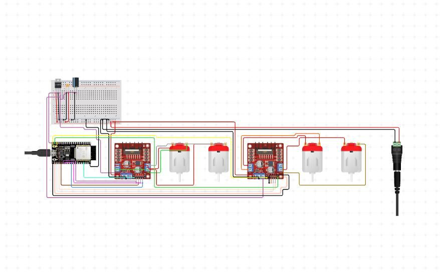

# The Nonchalant

### A Hand Gesture Controlled Car Using ESP32

The Nonchalant is a 4 wheel drive car that I made using ESP32 and a few sensors

I wanted to make something that I could control without using a normal remote

So I tried using hand movements to control the car

I used an MPU9250 sensor to detect the movement of my hand and two ESP32 boards to send and receive commands using ESP NOW

I also added an ultrasonic sensor to detect obstacles


## 1 How It Works

The idea is simple

I tilt my hand and the car moves in that direction

The MPU9250 reads the movement and sends it to the first ESP32

That ESP32 sends a command to the ESP32 on the car using ESP NOW

The second ESP32 receives the command and controls the motors using an L298N motor driver

These are the controls

- Tilt forward to move forward
- Tilt left to turn left
- Tilt right to turn right
- Keep my hand level to stop
- Tilt backward to change reverse mode
- Tilt backward again to change back

I set the tilt limit to 15 degrees

The controller sends commands every 100 milliseconds

For turning I control the motors on the left and right separately

I also placed an HC SR04 sensor at the front of the car

When something is closer than 20 cm the car stops turns right for a short time and stops again

### Working Flow

```text
Hand Movement
      |
   MPU9250
      |
Controller ESP32
      |
    ESP NOW
      |
  Car ESP32
      |
     L298N
      |
   4 Motors
```

## 2 Bill of Materials

| Part | Qty. | Purpose | Link |
|---|---:|---|---|
| ESP32 development board | 2 | Hand controller and car receiver | [Product page](https://robu.in/product/esp-wroom-32-wifi-bluetooth-networking-smart-component-development-board/) |
| MPU-9250 IMU | 1 | Reads hand tilt | [Product page](https://robu.in/product/mpu-9250-9-axis-attitude-gyro-accelerometer-magnetometer-sensor-module/) |
| L298N motor driver | 1 | Drives the left and right motor pairs | [Product page](https://robu.in/product/l298n-2a-based-motor-driver-module/) |
| BO geared DC motor | 4 | Drives the wheels | [Product page](https://robu.in/product/dual-shaft-bo-motor-straight/) |
| 65 mm robot wheel | 4 | Fits the BO motor shafts | [Product page](https://robu.in/product/smart-car-robot-plastic-tire-wheel/) |
| HC-SR04 ultrasonic sensor | 1 | Detects obstacles in front of the car | [Product page](https://robu.in/product/ultrasonic-transceiver-module-hc-sr04/) |
| 7.4 V, 2-cell battery pack | 1 | Powers the car | [Product page](https://robu.in/product/orange-2s-7-4v-2200mah-25c-lithium-polymer-battery-pack-lipo/) |
| 3D-printed chassis parts | As needed | Holds the motors and electronics | [CAD files](3D%20Cad/The%20Nonchalant.step) |

The links are examples for the parts used in this build; equivalent parts should work if their specifications match.

## 3 Wiring

### Hand Controller

I connected the MPU9250 to the first ESP32

| MPU9250 | ESP32 |
|---|---|
| VCC | 3V3 |
| GND | GND |
| SDA | GPIO 15 |
| SCL | GPIO 14 |

### Motor Driver

I connected the L298N to the ESP32 on the car

| L298N | ESP32 |
|---|---|
| IN1 | GPIO 26 |
| IN2 | GPIO 25 |
| IN3 | GPIO 17 |
| IN4 | GPIO 16 |
| ENA | GPIO 32 |
| ENB | GPIO 33 |

The left two motors are connected to one side of the motor driver

The right two motors are connected to the other side

This lets me change the speed of each side when turning

### Ultrasonic Sensor

| HC SR04 | ESP32 |
|---|---|
| VCC | 5V |
| GND | GND |
| TRIG | GPIO 18 |
| ECHO | GPIO 19 |

The Echo pin goes through a resistor divider before connecting to the ESP32

This brings the 5V signal down to 3.3V

I connected all the grounds together and powered the motors through the motor driver

### Circuit Diagram



## 4. Getting the Code Running

I used Arduino IDE for coding both the ESP32 boards. Since both of them had different jobs, I had to upload seperate codes.

The ESP32 on my hand reads the MPU9250 and sends the commands, while the one on the car recieves them and controls the motors.

Before uploading I installed the ESP32 board package and the `MPU9250_asukiaaa` library.

For ESP NOW to work I needed the MAC address of the ESP32 on the car. I got the address and put it in the `carMAC` variable in my controller code.

### How to set it up

1. Install Arduino IDE and ESP32 board package.
2. Install the `MPU9250_asukiaaa` library.
3. Find the MAC address of the ESP32 on the car.
4. Open `GestureController` and change the `carMAC` to your ESP32 address.
5. Upload `GestureController` to the hand controller.
6. Upload `GestureCarReceiver` to the car.
7. Open serial monitor at 115200 baud and check if both boards are communicating.

One thing I would suggest is testing the motors without keeping the car on the ground, otherwise it might just start moving while your still checking stuff.

Also the MAC address in my code is just an example so you'll have to change it.

## 5. Designing the Car

I used Fusion 360 to make the car body.

I didnt really plan anything too complicated. I just wanted a chassis that could fit the 4 motors, battery and all the electronics without making it too crowded.

The main problem was fitting everything while still leaving some space for the wires.

I ended up making a pretty basic design and used 3D printed parts for the chassis.

This is how the model looks.


I also uploaded the design files incase anyone wants to modify it or use it for their own project.

- [Fusion 360 Design](3D%20Cad/The%20Nonchalant%20%281%29.f3d)
- [STEP File](3D%20Cad/The%20Nonchalant.step)

## 6. Putting Everything Together and Testing

After assembling the car and uploading the codes I started testing everything.

First I checked if both ESP32 boards were communicating properly because without that the car wouldnt do anything.

Then I tried tilting my hand forward, left and right to check if the motors were responding.

I also tested the reverse mode. Instead of keeping my hand tilted backward to reverse, I made it so that tilting backward changes the mode. Tilting it backward again switches it back to normal.

After that I tested the ultrasonic sensor.

I placed an object in front of the car to see if it detects it when the distance goes below 20 cm.

I programmed it so the car stops, turns right for a short time and then stops again.

I added this because I didnt want the car to just keep going forward and hit something everytime theres an obstacle.

### Demo Video

[Watch the Driving Video](assets/VIDEO-2026-10-23-02-05-10.mp4)

## 7. Project Files

I have uploaded pretty much everything related to the project in the repository.

- `GestureController` - Code for the ESP32 on my hand.
- `GestureCarReceiver` - Code for the ESP32 on the car.
- `3D Cad` - Fusion 360 model and STEP file.
- `assets` - Photos, circuit diagram and the video.
- [JOURNAL.md](JOURNAL.md) - My build log where I wrote about making the car.

Thats pretty much it for The Nonchalant.

I started this project because I wanted to try controlling a car without using a normal remote. I thought using hand gestures would be intresting so I decided to give it a try.

I got to learn quite a bit about ESP32, ESP NOW, sensors and motor control while making this.

Theres still a few things I wanna improve but for now I'm happy that I got the car working.
